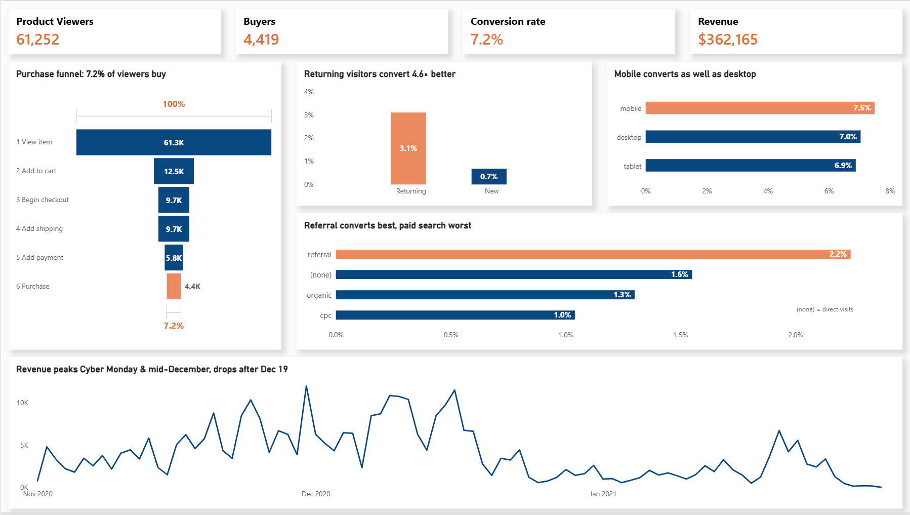
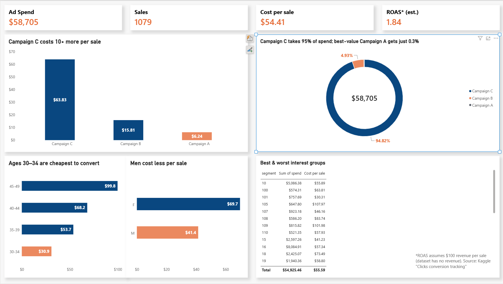

# E-commerce Funnel & Ad Efficiency Analysis

**Status:** analysis done; Power BI dashboard done (2 pages); written report in progress

A personal portfolio project. It looks at where an online store loses its customers, and at which ad campaigns and audiences give the best return. Only public datasets are used, and any assumption is labelled.

## Dashboard
**Page 1: Online store performance** (Power BI)

**Page 2: Ad efficiency** (Power BI)

## Questions
1. Where in the purchase funnel do shoppers drop off?
2. Which traffic channels bring buyers, and how much do they spend?
3. How do new and returning customers, and mobile and desktop users, differ?
4. Which ad campaigns and audiences cost the least per sale?

## Data
| Dataset | Source | Used for |
|---|---|---|
| Google Merchandise Store GA4 sample (Nov 2020 – Jan 2021, 4.3M events, 270K users) | `bigquery-public-data.ga4_obfuscated_sample_ecommerce` | Funnel, channels, segments, trends, products |
| Facebook ad campaigns (1,143 ads, $58.7K spend) | [Kaggle: Clicks conversion tracking](https://www.kaggle.com/datasets/loveall/clicks-conversion-tracking) | CTR, CPC, cost per sale, ROAS |

The two datasets aren't linked, so they are presented as two separate analyses, not as an attribution model.

## Method
- **SQL (BigQuery):** [`sql/ga4_funnel_queries.sql`](sql/ga4_funnel_queries.sql) has 7 queries: data check, funnel, channels, new vs returning, daily trend, device funnel and top products. Their results are in [`data/`](data).
- **Python (pandas):** [`python/ad_efficiency.py`](python/ad_efficiency.py) computes the ad metrics by campaign, age, gender and interest.
- **Power BI:** the dashboard is in [`dashboard/`](dashboard).

## Key findings
**Funnel and customers (GA4)**
- **7.2%** of product viewers go on to buy. The biggest leak comes first: **80% view a product but never add it to the cart.**
- 41% of shoppers who enter shipping details never add payment, which is the second-biggest leak.
- **Returning visits convert 4.6× better than new ones** (3.1% vs 0.68%) and bring in two-thirds of revenue.
- Referral traffic converts best of the named channels (2.2%). Paid search converts worst (1.0%) but has the highest average order ($78).
- Mobile converts as well as desktop (7.5% vs 7.0%).
- Revenue peaks on Cyber Monday and Dec 8–16, then falls sharply after Dec 19 (likely the holiday shipping cut-off).
- The **Navy Speckled Tee** has the most views (56K) and a 25% add-to-cart rate, but a 0.3% purchase rate, so it's a cart-abandonment candidate.

**Ad efficiency (Facebook ads)**
- **Campaign C takes 95% of the spend but costs $64 per sale**, compared with $16 (B) and $6 (A).
- Ages 30–34 cost $31 per sale and ages 45–49 cost $100, even though the 45–49 group has the highest click rate.
- Men cost $41 per sale and women $70.
- The best interest groups (#2, 65, 101, 21) cost about $26–31 per sale; the worst (#27, 109, 105) about $96–108.

## Recommendations
1. Test moving budget from Campaign C to Campaigns A and B, and toward ages 30–34 and the top interest groups.
2. Improve product pages, where the drop is largest (photos, sizing, reviews), and simplify the payment step.
3. Invest in retention (email, remarketing), because returning customers are worth far more.

## Limitations & assumptions
- GA4 sample: Google obfuscates the data. About 42% of users have a hidden or "(none)" traffic source. Order counts are near zero on Nov 1–10 and in late January, while revenue still appears (transaction IDs are missing in the sample), so trend comparisons use revenue or the Nov 11 – Jan 25 window.
- The funnel counts users who did each step at any time, not a strict in-order path.
- **The ad data has no revenue. ROAS assumes $100 per approved sale** and is shown only to illustrate the method.
- The data is historical (2017–2021). It's used to show the analysis approach, not to describe current performance.
