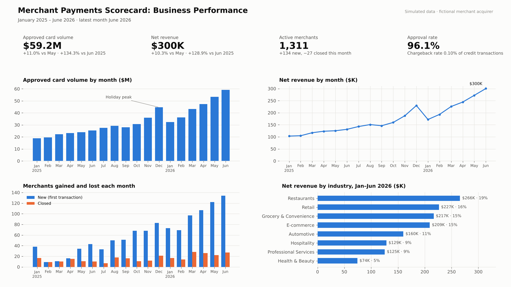
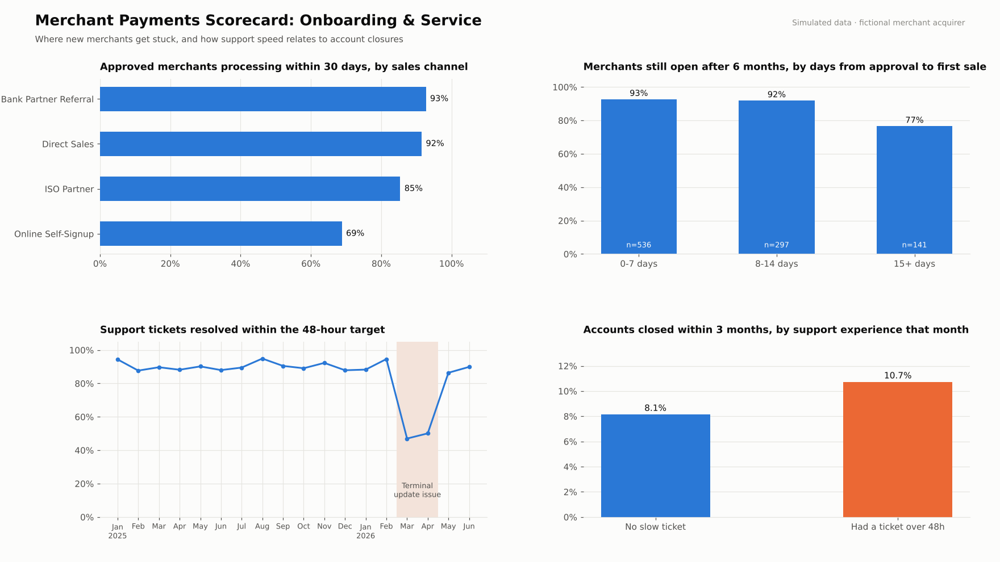

# Merchant Payments Performance Scorecard

**Status:** ✅ Complete. Includes SQL data-quality checks and analysis, an automated monthly refresh (Python + Jupyter), an Excel leadership scorecard and a 2-page dashboard.

A personal portfolio project. It shows the recurring reporting an analytics team at a payments company does every month: check the data, build one trusted set of numbers, and turn them into a scorecard leaders can act on. It covers product performance, merchant onboarding, revenue, sales channels and service levels.

> **About the data:** real merchant payment data is confidential, so this project uses **simulated data** for a fictional Canadian merchant acquirer (a company that lets small businesses accept card payments). The data is created by [`python/generate_data.py`](python/generate_data.py) with a fixed seed, and every assumption is written in that file. A few data-quality problems were added on purpose so the checks have something real to catch.

## Dashboard

**Page 1: Business performance**



**Page 2: Onboarding & service**



## Business questions
1. How are volume, revenue and the merchant base trending, month over month?
2. Which sales channels bring in merchants who actually start processing, and stay?
3. Which industries and products drive revenue, and which carry more risk (declines, chargebacks)?
4. Are we meeting our support service levels, and does slow support cost us merchants?

## What's in the project
| Part | File | What it does |
|---|---|---|
| Data quality | [`sql/01_data_quality.sql`](sql/01_data_quality.sql) | 10 checks run before every refresh: duplicates, missing values, label errors, impossible timestamps, logic checks |
| Clean tables | [`sql/02_clean_tables.sql`](sql/02_clean_tables.sql) | Fixes the issues and applies the business rules (revenue, SLA) in one place |
| Analysis | [`sql/03_scorecard_queries.sql`](sql/03_scorecard_queries.sql) | 8 queries using CTEs, joins, window functions (`LAG`, `ROW_NUMBER`) and a median calculation |
| Automation | [`python/refresh_report.py`](python/refresh_report.py) | One command reruns everything: SQL → CSVs → Excel → dashboard |
| Notebook | [`notebooks/monthly_refresh.ipynb`](notebooks/monthly_refresh.ipynb) | Runs the monthly refresh and walks through the results |
| Excel scorecard | [`outputs/merchant_scorecard.xlsx`](outputs/merchant_scorecard.xlsx) | Pick a month from a drop-down; every KPI updates with formulas (`INDEX/MATCH`, `OFFSET`, `AVERAGE`), with change vs last month and vs the 6-month average, colour-coded |
| Definitions | [`docs/metric_definitions.md`](docs/metric_definitions.md) | Every metric, business rule and data-quality rule, written down |

## Key findings
**Growth (June 2026)**
- Approved card volume reached **$59.2M** and net revenue **$300K**, both more than double June 2025. Growth is coming from new merchants: 134 started processing in June, compared with 43 a year earlier.

**Onboarding is the biggest opportunity**
- **Online Self-Signup** brings in the most applications (35%), but only **69% of approved merchants start processing within 30 days**, against 92–93% for Bank Partner and Direct Sales. Its 6-month retention is also lowest (83% vs 93–94%).
- These are still valuable merchants: they earn the **most revenue per active month ($295 vs about $205)**, because most choose flat-rate pricing.
- Speed matters: merchants who make their first sale within 14 days of approval are **92% still open after 6 months**, against **77%** for those who take longer.

**Service levels: the March–April 2026 terminal issue**
- A terminal software update drove **578 terminal tickets in two months**, about 11 times the normal rate. Tickets resolved within 48 hours fell from about 90% to **47–50%**, and CSAT dropped from about 4.1 to **3.4**. Every ticket type slowed down, not only terminal issues.
- Merchants who waited more than 48 hours for help closed their account within 3 months **10.7% of the time, against 8.1%** for everyone else (about a third higher).

**Product, risk and card mix (Jan–Jun 2026)**
- The **Online Gateway** has a lower approval rate (92.2% vs 96.6%) and a chargeback rate about 8 times that of in-person products (0.40% vs 0.05%), so it is worth watching as e-commerce grows.
- **Interac Debit** is 35% of volume but only 22% of processing revenue; Visa and Mastercard are 57% of volume and 74% of revenue.

## Recommendations
1. **Fix online activation first.** Contact approved online merchants who haven't processed a sale by day 7 (email, then a call) and target 80% activation within 30 days. Rough estimate: about 30 more active merchants after a year, worth around **$9K more net revenue a month**.
2. **Roll out terminal updates in stages** (for example, 10% of terminals first) and add temporary support staff during rollouts. Add an alert when the 48-hour SLA drops below 80%.
3. **Keep the scorecard automated.** The monthly refresh replaces manual copy-and-paste, so analysts spend their time on the "why", not on rebuilding numbers.

## How to run it
```bash
cd python
python generate_data.py    # optional: re-creates the simulated raw data (same seed = same data)
python refresh_report.py   # runs all checks and queries, rebuilds outputs/ and dashboard/
```
Needs Python 3 with pandas, matplotlib and openpyxl. The SQL runs in SQLite so there's nothing to install; the `.sql` files note the small changes needed for Snowflake (e.g. `DATEDIFF`, `MEDIAN`).

## Limitations
- The data is simulated. The patterns are realistic but were built in on purpose, so the findings show the analysis method, not real market results.
- Revenue uses simple, labelled margin assumptions, not a full interchange and fee model.
- The link between slow tickets and account closures is a correlation. A real analysis would also control for merchant size and tenure.
