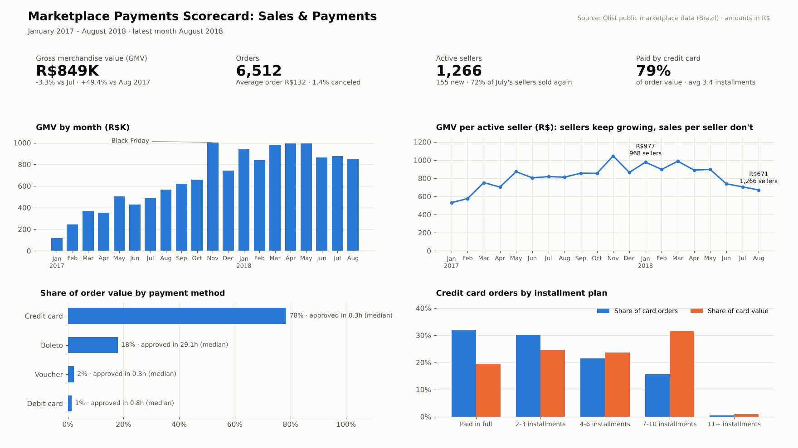
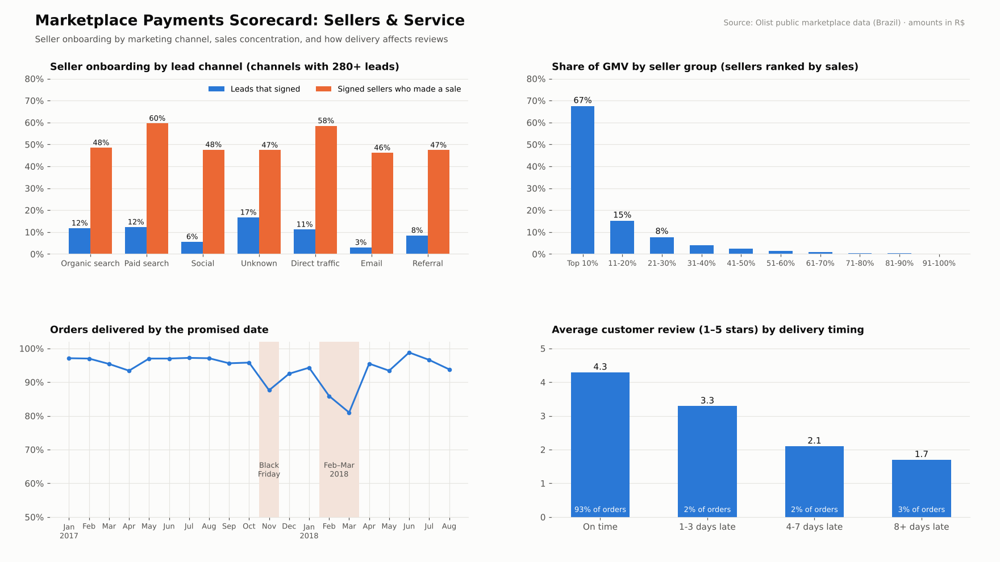

# Marketplace Payments & Merchant Performance Scorecard

**Status:** ✅ Complete. Includes SQL data-quality checks and analysis, an automated monthly refresh (Python + Jupyter), an Excel leadership scorecard and a 2-page dashboard.

A personal portfolio project. It recreates the recurring reporting an analytics team at a payments or commerce company runs every month: check the data, build one trusted set of numbers, and turn them into a scorecard leaders can act on. It covers payment methods, merchant (seller) onboarding, sales performance, service levels and customer experience.

**Data:** real, anonymized data from [Olist](https://www.kaggle.com/datasets/olistbr/brazilian-ecommerce), a Brazilian online marketplace: 99,000 orders, 3,000 sellers and 8,000 seller sign-up leads, January 2017 – August 2018. Amounts are in Brazilian reais (R$). Download steps are in [`data/README.md`](data/README.md).

## Dashboard

**Page 1: Sales & payments**



**Page 2: Sellers & service**



## Business questions
1. How are sales, orders and the seller base trending, month over month?
2. How do customers pay, and how do payment methods differ in approval speed and order size?
3. Which marketing channels bring in sellers who actually start selling?
4. Are orders delivered on time, and what does a late delivery cost in customer satisfaction?

## What's in the project
| Part | File | What it does |
|---|---|---|
| Data quality | [`sql/01_data_quality.sql`](sql/01_data_quality.sql) | 13 checks run before every refresh: missing records, duplicates, payment totals that don't match, impossible timestamps, missing categories |
| Clean tables | [`sql/02_clean_tables.sql`](sql/02_clean_tables.sql) | Joins 10 source tables into reporting tables and applies the business rules in one place |
| Analysis | [`sql/03_scorecard_queries.sql`](sql/03_scorecard_queries.sql) | 10 queries using CTEs, joins, window functions (`LAG`, `ROW_NUMBER`, `NTILE`, running totals) and median calculations |
| Automation | [`python/refresh_report.py`](python/refresh_report.py) | One command reruns everything: raw files → SQL → CSVs → Excel → dashboard |
| Notebook | [`notebooks/monthly_refresh.ipynb`](notebooks/monthly_refresh.ipynb) | Runs the monthly refresh and walks through the results |
| Excel scorecard | [`outputs/merchant_scorecard.xlsx`](outputs/merchant_scorecard.xlsx) | Pick a month from a drop-down and 15 KPIs update with formulas (`INDEX/MATCH`, `OFFSET`, `AVERAGE`), showing change vs last month and vs the 6-month average, colour-coded |
| Definitions | [`docs/metric_definitions.md`](docs/metric_definitions.md) | Every metric, business rule and data-quality rule, written down |

## Key findings
**Growth has stalled, and sales per seller are falling**
- Monthly GMV grew from R$120K in January 2017 to a Black Friday peak of R$1.0M (November 2017), then levelled off at about R$840K–1.0M a month through 2018.
- Active sellers kept rising (968 in January 2018 to 1,266 in August, +31%), but **GMV per active seller fell from R$977 to R$671 (−31%)**. New sellers are adding fewer sales than the existing ones.
- Sales are concentrated: **the top 10% of sellers make 67% of GMV**, while the bottom half make about 3%.

**Payments**
- Credit cards pay for 76% of orders and 79% of order value. Boleto (a bank payment slip) is 20% of orders, but its **median time to payment approval is 29 hours, against 0.3 hours for cards**, which delays every boleto order before it can ship.
- **68% of card orders are split into installments.** Plans of 7–10 installments are only 16% of card orders but **32% of card value**, with an average order of R$334 against R$101 for orders paid in full.

**Seller onboarding**
- Of 8,000 seller leads, 842 signed (10.5%). But **only 51% of signed sellers made even one sale** (deals signed by June 2018).
- **Paid search** brings the best mix: 12% of leads sign and 60% of those start selling. Social media (6% sign) and email (3%) convert poorly.
- Large online sellers ("online big") start selling 69% of the time and bring R$2,680 GMV each; offline and industry sellers start only about a third of the time and bring about R$215–265 each.

**Delivery and customer experience**
- 93% of orders arrive by the promised date, but this fell to 88% at Black Friday and **81–86% in February–March 2018**.
- Lateness is very costly: reviews average **4.3 stars on time but 1.7 stars when 8+ days late**, and 79% of those are 1–2 stars.
- When sellers ship late (9% of orders), deliveries are late 21% of the time against 5%. But most late deliveries (72%) happen even when the seller shipped on time, so carrier transit is the bigger problem. Rio de Janeiro and Bahia are the weakest large states (88% on time vs 95.5% in São Paulo).

## Recommendations
1. **Activate signed sellers.** Half never make a sale. Add a 30-day onboarding plan (listing help, a check-in call) and shift marketing budget toward paid search and larger online sellers, away from email and social.
2. **Grow sales per seller, not only seller count.** Track GMV per active seller alongside seller count, and support mid-sized sellers (the 11–50% groups) with promotion tools.
3. **Plan carrier capacity before peaks** and review routes into Rio de Janeiro and Bahia. Set delivery estimates by region so promises are realistic. Late deliveries are the main driver of 1–2 star reviews.
4. **Speed up boleto orders**, for example with payment reminders before the slip expires, and keep promoting installment plans for high-value orders.

## How to run it
```bash
# 1. download the Olist files into data/raw/  (see data/README.md)
cd python
python refresh_report.py   # runs all checks and queries, rebuilds outputs/ and dashboard/
```
Needs Python 3 with pandas, matplotlib and openpyxl. The SQL runs in SQLite so there's nothing to install; the `.sql` files note the small changes needed for Snowflake (e.g. `DATEDIFF`, `MEDIAN`).

## Limitations
- Olist is a Brazilian marketplace from 2017–2018, not a card processor. The metrics (payment mix, approval speed, merchant onboarding, service levels) are the same kind a payments company tracks, but the numbers describe Olist.
- Olist's own revenue (its commission) isn't in the data, so performance is measured in GMV.
- Links such as late delivery and low reviews are correlations, not proof of cause.
