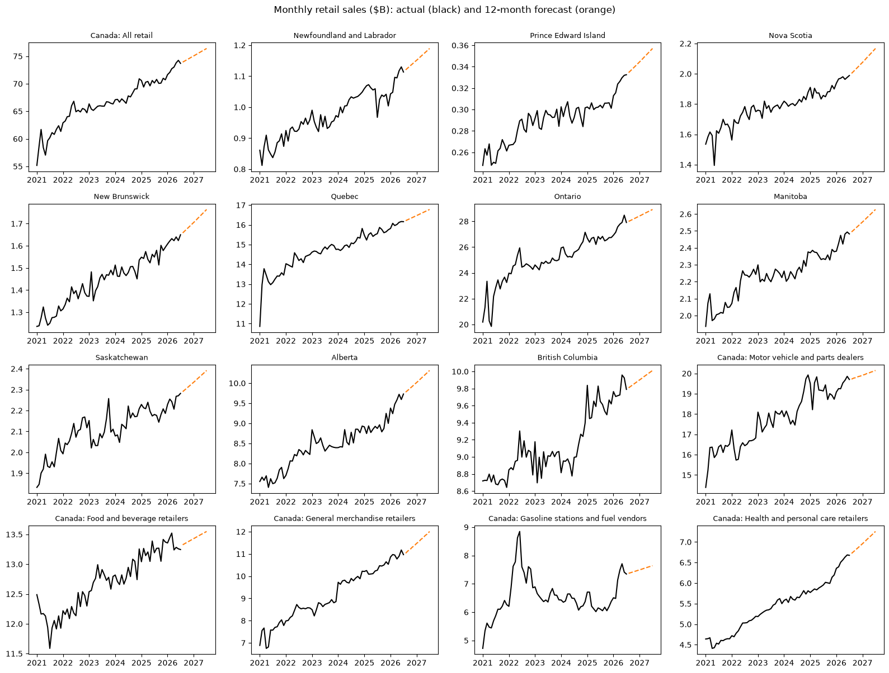

# Canadian Retail Sales Forecast

**Status:** complete (Oct 2026) · **[Read the report](report.md)**

A forecasting project on Statistics Canada's official monthly retail trade data. It forecasts retail sales 12 months ahead for Canada, the 10 provinces and the 5 biggest store types, and tests every model on a year of data it never saw (backtesting).

## Key results
- Canadian retail sales forecast to grow **about 4.4%** (Aug 2026 – Jul 2027)
- Best models cut the average monthly error to **2.0%**, versus **3.9%** for the naive baseline
- Fastest-growing provinces: **PEI, Newfoundland and Labrador, Alberta** (+8% to +9%); slowest: **BC** (+2%)
- Keeping pre-COVID data **helped**: full history beat post-COVID-only training for **12 of 16** series
- Strongest store types: **health and personal care** (+10%) and **general merchandise** (+7%); food and beverage nearly flat (+1%)

## Why it matters
- **Government planning:** which provinces will see the most retail activity and sales-tax revenue
- **Retailer planning:** which store types are growing, for stock, staffing and new locations
- **Payments:** retail spending drives card transaction volume

## Approach
- **Data:** Statistics Canada Table 20-10-0056-01, seasonally adjusted, Jan 2017 – Jul 2026 (real public data, downloaded automatically)
- **Models:** naive baseline, drift, exponential smoothing (damped trend), ARIMA with a COVID flag
- **COVID (Mar 2020 – Jun 2021):** kept in the data but flagged, so the shock doesn't distort the trend
- **Training window test:** full history (2017+) vs post-COVID only (Jul 2021+); the more accurate one is used
- **Backtest:** trained on data up to Jul 2025, forecast Aug 2025 – Jul 2026, compared with actual sales (MAPE); each series then uses its best model
- **Tools:** Python (pandas, statsmodels, matplotlib), Jupyter

## Files
| File | What it is |
|---|---|
| [`report.md`](report.md) | Findings, recommendations and limitations |
| [`notebooks/01_explore.ipynb`](notebooks/01_explore.ipynb) | First look at the data and the 6 analysis decisions |
| [`notebooks/02_forecast.ipynb`](notebooks/02_forecast.ipynb) | Full pipeline: download, models, backtest, forecast |
| [`outputs/`](outputs) | Backtest errors, growth table, charts |

*Personal project; not financial advice.*
