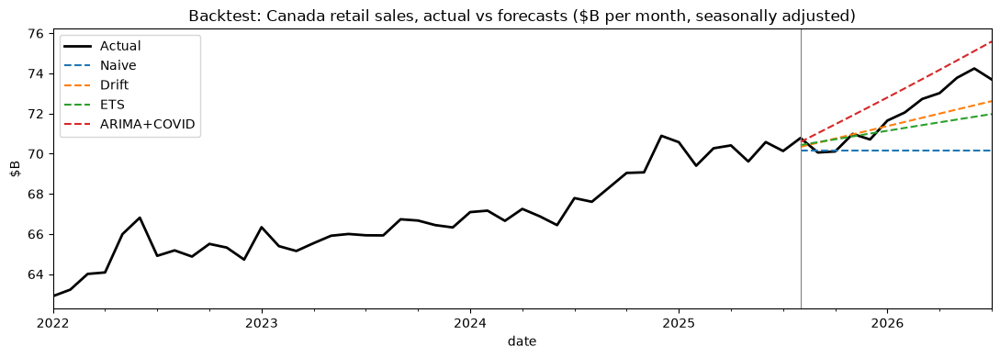

# Canadian Retail Sales Forecast: Report

**Data:** Statistics Canada, Table 20-10-0056-01, *Monthly retail trade sales by province and territory* (seasonally adjusted, Jan 2017 – Jul 2026)
**Forecast period:** Aug 2026 – Jul 2027
**Backtest period:** Aug 2025 – Jul 2026 (models trained only on data up to Jul 2025)

## Summary
- **Canadian retail sales are forecast to grow about 4.4%** over the next 12 months, from $864B to $902B.
- **Forecasting beats guessing.** Using each series' best model, the average monthly error in the backtest was **2.0%**, versus **3.9%** for the simple baseline of repeating last month's sales.
- **Fastest-growing provinces:** Prince Edward Island (+9.3%), Newfoundland and Labrador (+8.4%) and Alberta (+8.0%). **Slowest:** British Columbia (+2.1%).
- **Store types:** health and personal care (+10.0%) and general merchandise (+6.9%) lead; food and beverage is almost flat (+1.0%).
- **Gas stations are not predictable with these models** (about 9% error for every model), so their +11.3% forecast should not be relied on.

## What was forecast
16 monthly series:
- **Canada total**, for an overall view
- **The 10 provinces**, for government planning (tax revenue, infrastructure, local economic policy)
- **The 5 biggest store types in Canada** (by sales over the last 12 months), for retailer planning (stock, staffing, store openings): motor vehicle and parts, food and beverage, general merchandise, gas stations, and health and personal care

Seasonally adjusted data was used so the forecasts show the underlying trend, not the December holiday spike.

## Models
| Model | How it works |
|---|---|
| Naive | Next 12 months = last known month (the baseline every model must beat) |
| Drift | Continues the average monthly change since July 2021 (after COVID) |
| ETS (damped trend) | Exponential smoothing; COVID months smoothed over so the shock doesn't distort the trend |
| ARIMA + COVID flag | ARIMA(1,1,1) with a 0/1 flag for Mar 2020 – Jun 2021 as an extra input |

All COVID months were **kept but flagged**, so the models learn from the full history without treating the 2020 crash and rebound as normal behaviour.

## Backtest results
Each model forecast Aug 2025 – Jul 2026 using only data up to Jul 2025. Error is MAPE (average % miss per month; lower is better).

| Model | Average error | Times it was the best model |
|---|---|---|
| Drift | 2.43% | 5 of 16 |
| ARIMA + COVID flag | 2.59% | 10 of 16 |
| ETS | 2.83% | 1 of 16 |
| Naive | 3.86% | 0 of 16 |

**Takeaway:** no single model wins everywhere. ARIMA was best most often, especially for smaller provinces, while simple Drift was best for the largest series (Canada, Ontario, Quebec, BC). So each series uses its own best model for the final forecast.

All models except Naive caught the upward trend; actual sales grew a little faster than Drift and ETS expected in 2026.

## 12-month forecast
| Series | Last 12 months | Next 12 months | Growth |
|---|---|---|---|
| Canada: all retail | $863.8B | $901.9B | +4.4% |
| Ontario | $327.1B | $341.5B | +4.4% |
| Quebec | $191.0B | $197.9B | +3.6% |
| British Columbia | $116.5B | $118.9B | +2.1% |
| Alberta | $111.6B | $120.5B | +8.0% |
| Manitoba | $28.9B | $30.7B | +6.1% |
| Saskatchewan | $26.6B | $28.1B | +5.4% |
| Nova Scotia | $23.2B | $25.0B | +7.7% |
| New Brunswick | $19.3B | $20.5B | +6.5% |
| Newfoundland and Labrador | $12.8B | $13.9B | +8.4% |
| Prince Edward Island | $3.8B | $4.1B | +9.3% |
| Motor vehicle and parts dealers | $231.1B | $239.2B | +3.5% |
| Food and beverage retailers | $159.7B | $161.3B | +1.0% |
| General merchandise retailers | $129.2B | $138.2B | +6.9% |
| Gas stations and fuel vendors | $80.9B | $90.1B | +11.3% (low confidence) |
| Health and personal care retailers | $76.2B | $83.8B | +10.0% |

## Recommendations
**For government planning**
1. Alberta and the Atlantic provinces should plan for above-average growth in sales-tax revenue and retail activity (+6.5% to +9.3%).
2. BC's slower forecast (+2.1%) and its jumpy recent data are worth watching before setting revenue targets.

**For retailers**
1. Health and personal care and general merchandise have the strongest momentum; they are good candidates for extra stock, staff or new locations.
2. Food and beverage is close to flat in dollar terms; growth there will have to come from market share, not market growth.
3. Don't plan on the gas station forecast. Fuel sales follow oil prices, which these models can't see.

## Limitations
- **One backtest window.** Models were compared on a single 12-month period. Testing several past cutoffs would give a more reliable ranking.
- **Picking the best model on the same test period** makes the 2.0% error slightly optimistic.
- **Dollar sales include inflation.** Part of the growth is higher prices, not more items sold. StatCan's volume table (20-10-0067-01) could separate the two.
- **No outside drivers.** Interest rates, fuel prices and population growth are not in the models; adding them is the natural next step.
- **Seasonally adjusted data** shows the trend; planning for December peaks would need the unadjusted series.

## Files
- [`notebooks/01_explore.ipynb`](notebooks/01_explore.ipynb): first look at the table and the 6 analysis decisions
- [`notebooks/02_forecast.ipynb`](notebooks/02_forecast.ipynb): data download, models, backtest and forecast (with outputs)
- [`outputs/`](outputs): backtest errors, growth table and charts
