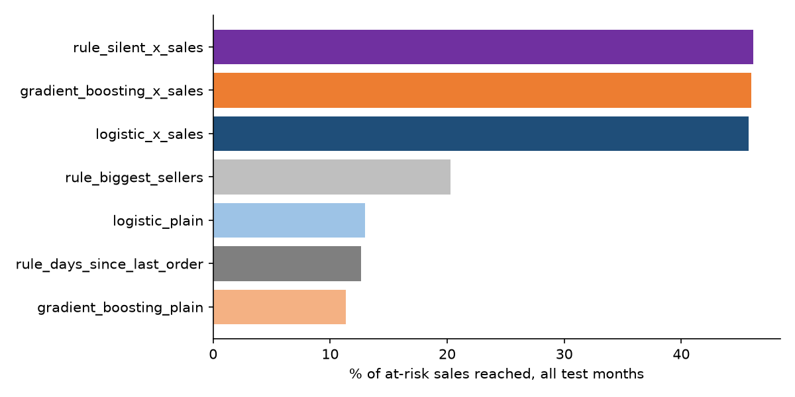
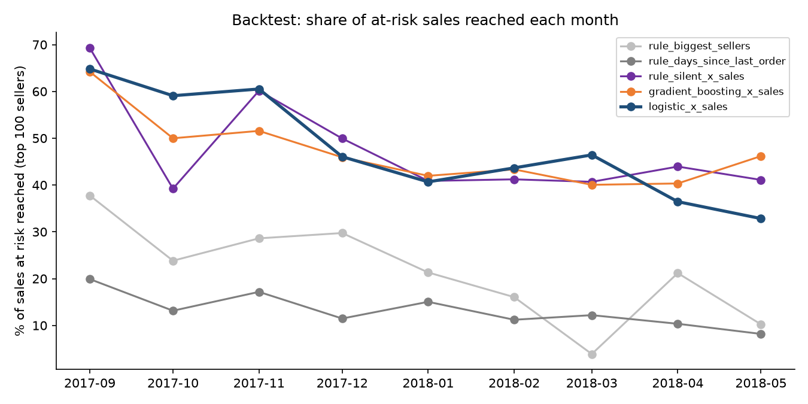
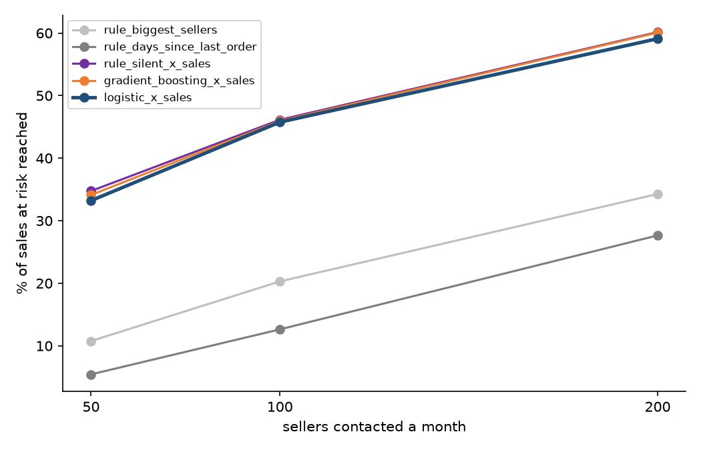

# Seller Churn Prediction with a Rolling Backtest

**Status:** ✅ Complete. Three runs on the full Olist data and a round of review fixes are done (see Results).

A personal portfolio project. Which active sellers on an online marketplace are likely to stop selling in the next 90 days, and how much of the sales at risk can a limited outreach budget reach? A marketplace or payments team could use the answer to decide which merchants an account manager calls first.

**Data:** real, anonymized data from [Olist](https://www.kaggle.com/datasets/olistbr/brazilian-ecommerce), a Brazilian online marketplace (3,000 sellers, 2017 to August 2018). Download steps: [`data/README.md`](data/README.md). It builds on the cleaned tables from the [Merchant Payments Scorecard](../merchant-payments-scorecard).

## Approach
1. **Seller-month table.** For every month start from April 2017, one row per active seller (1+ order in the last 90 days), with features built only from what was known on that date (a late flag or review counts only if it had already happened).
2. **Label.** `churned = 1` if the seller has no orders in the next 90 days.
3. **Features.** Orders and sales over the last 30 and 90 days and the 90 days before that, days since the last order, tenure, average order value, late-delivery rate, average and low review scores, main category, state and sign-up channel.
4. **Rolling backtest.** For each test month, models train only on earlier months whose 90-day outcome was already known on that date, so the model never sees the future.
5. **Models.** The headline model is logistic regression, ranking sellers by churn probability x sales in the last 90 days (expected money lost). Gradient boosting with the same ranking is a comparison. Both are tested against three simple rules: contact the sellers who have been silent the longest, the biggest recent sellers, or the highest days since last order x recent sales. **The final choice was fixed in run 3, after seeing test results, and no further variants will be tried.** The third rule was added afterwards, as a fair benchmark.
6. **Scored in money.** If outreach is limited to the top 100 sellers a month, what share of the sales at risk do they hold?

All analysis decisions are listed in [`docs/decisions.md`](docs/decisions.md).

## Files
| File | What it does |
|---|---|
| [`python/churn_pipeline.py`](python/churn_pipeline.py) | Builds the seller-month table, runs the rolling backtest and saves tables and charts. Run with `python churn_pipeline.py --data ../data/raw --out ../outputs` |
| [`notebooks/churn_backtest.ipynb`](notebooks/churn_backtest.ipynb) | Step-by-step walkthrough with exploration cells |
| [`docs/decisions.md`](docs/decisions.md) | The six analysis decisions and metric definitions |
| `outputs/` | Tables and charts from the latest run (`spread_by_model.csv`, `backtest_by_top_k.csv`, `money_each_order_once.csv`, `what_if_savings.csv`, `auc_by_seller_size.csv` and the charts). `outputs/v1/`, `outputs/v2/` and `outputs/v3/` hold the first three runs, from before the review fixes |
| [`outputs/rerun_linux/`](outputs/rerun_linux/) | CSV tables from a full rerun on a second computer (Linux), with a README describing its setup and how it compares. No charts |

## How to run
Use Python 3.13. Put the CSV files in `data/raw/` first ([`data/README.md`](data/README.md) says where to get them). From this folder:

```bash
pip install -r requirements.txt
cd python
python churn_pipeline.py --data ../data/raw --out ../outputs
```

## Results
The backtest covers 9 test months (September 2017 to May 2018), with monthly cutoffs and 100 sellers contacted a month. In every month about one in five active sellers stopped selling: the churn rate ran from 20.1% to 24.9%. Across the 9 months, sellers who churned held R$787,169 (Brazilian reais) in sales at risk, counting each order once.

**Two ways to add up the months.** A seller who stops selling stays "active" for up to three monthly cutoffs, so the same orders can sit in several months. "Share, all 9 months" adds up the months as they are, which is how each month would look to the team at the time, and it counts repeated sales again (R$1.39 million in total). "Share, each order once" counts every order one time. All reais totals below count each order once.

**How the project got here**
- **Run 1:** rank sellers by churn probability. The "biggest recent sellers" rule reached more than either model. Saved in `outputs/v1/`.
- **Run 2:** two changes to make the models care about big sellers, ranking by probability x sales ("x_sales") and training with sales weights. Saved in `outputs/v2/`.
- **Run 3:** the final choice was fixed. **Logistic regression with x_sales is the headline model.** Gradient boosting with x_sales is kept as a comparison only. No further variants will be tried. Saved in `outputs/v3/`.
- **Review fixes (this version):** a review before publishing found problems, now fixed. Late flags and reviews now count only if they had already happened on the cutoff date. Rare categories are grouped using training rows only. June 2018 is dropped because its 90-day outcome ran into the data's incomplete last days. Reais totals now count each order once. A third simple rule was added: days since last order x recent sales.

These choices were made after seeing test results, so no month is truly held out and the results may flatter the approaches chosen. The numbers for runs 1 to 3 in their folders come from before the fixes.

**Headline: share of sales at risk reached with 100 sellers a month**

| Approach | Share, all 9 months | Share, each order once | Median month | Lowest month | Highest month | Months beating the biggest-sellers rule | Months beating the silent x sales rule |
|---|---|---|---|---|---|---|---|
| **Logistic regression, x_sales (headline)** | **45.8%** | **49.1%** | 46.0% | 32.8% | 64.8% | 9 of 9 | 4 of 9 |
| Gradient boosting, x_sales (comparison) | 46.0% | 51.6% | 45.9% | 40.0% | 64.2% | 9 of 9 | 4 of 9 |
| Rule: silent x sales (no model) | 46.1% | 54.1% | 41.2% | 39.2% | 69.3% | 9 of 9 | not applicable |
| Rule: biggest recent sellers | 20.3% | 24.7% | 21.3% | 3.9% | 37.8% | not applicable | 0 of 9 |
| Rule: silent the longest | 12.6% | 21.7% | 12.2% | 8.2% | 19.9% | 1 of 9 | 0 of 9 |

Counting each order once, the headline model reached R$386,372 of the R$787,169, gradient boosting R$406,095 and the silent x sales rule R$425,806.




**What this says**
- **Multiplying by sales does most of the work, not the model.** Ranking by churn probability alone, logistic regression reached 13.0% and gradient boosting 11.3%. Multiplying by sales took them to 45.8% and 46.0%. A simple rule with no model, days since last order x recent sales, reached 46.1%.
- **The models did not beat that simple rule.** The headline model beat it in 4 of 9 months, and so did gradient boosting. Counting each order once, the rule reached the most: 54.1%, against 51.6% and 49.1%. Across all 9 months the models and the rule are effectively tied (the rule leads by under 0.2 points, less than the run-to-run variation); counting each order once, the rule leads by 2.5 to 4.7 points. With 9 overlapping months, this shows the models add little beyond the rule on money. It does not show the rule is truly better.
- **The models pick more real churners.** Of their 900 picks, 317 (headline) and 305 (gradient boosting) really churned, against 265 for the rule.
- **The headline model beat the biggest-sellers rule in all 9 months, but the monthly numbers swing a lot.** The model ranged from 32.8% to 64.8% a month and the rule from 3.9% to 37.8%. The ranges overlap (the model's lowest month, 32.8%, is below the rule's best month, 37.8%), but the model was ahead in each month when compared on the same month.
- **The headline and comparison models are close overall, but the headline model is weakest at the end.** They reached 45.8% and 46.0%, and the headline model was ahead in 6 of the 9 months. The gap ran from 9.1 points in the headline model's favor to 13.3 points against it. In the last month, May 2018, it reached 32.8% against 46.2%. The headline was fixed as logistic regression by choice, not because it scored highest. This data cannot say which of the two is better.
- **The share reached falls over time.** For the headline model it goes from 64.8% in September 2017 to 32.8% in May 2018. The pool of active sellers grows from 905 to 1,487 a month, which may be why (not tested).

**Does it hold at other outreach sizes?** The same backtest with 50, 100 and 200 sellers contacted a month (`outputs/backtest_by_top_k.csv`):

| Approach | 50 sellers | 100 sellers | 200 sellers |
|---|---|---|---|
| Logistic regression, x_sales (headline) | 33.2% | 45.8% | 59.1% |
| Gradient boosting, x_sales (comparison) | 34.1% | 46.0% | 60.1% |
| Rule: silent x sales (no model) | 34.7% | 46.1% | 60.1% |
| Rule: biggest recent sellers | 10.8% | 20.3% | 34.3% |
| Rule: silent the longest | 5.4% | 12.6% | 27.6% |

Both x_sales models beat the "biggest recent sellers" rule in all 9 months at every size. In this run, neither model beat the silent x sales rule's total at any size: each won 3 of 9 months at 50 sellers, 4 of 9 at 100 and 4 of 9 at 200. On the Linux rerun, gradient boosting edged past that rule at 50 sellers across all 9 months (35.0% vs 34.7%), a gap smaller than the run-to-run variation. Counting each order once, the rule still leads at every size in both runs. The silent x sales rule beat the biggest-sellers rule in 9 of 9 months at 50 and 100 sellers and 8 of 9 at 200. The "silent the longest" rule beat it in 1 of 9 months at 50 sellers, 1 of 9 at 100 and 2 of 9 at 200.



**What if outreach saves part of it? (an assumption, not a result)** The data cannot show how much outreach would save. If outreach saved a share of the sales at risk that the headline model reaches (R$386,372 over the 9 months with 100 sellers a month, each order counted once), that would be:

| Assumed share saved | Reais over 9 months |
|---|---|
| 10% | R$38,637 |
| 20% | R$77,274 |
| 30% | R$115,912 |

**Tried and not needed.** In run 2 (10 months, before the review fixes), training with bigger sellers counting for more (sales weights) did not help. With weights alone, logistic regression reached 15.9% and gradient boosting 12.3%, both below the biggest-sellers rule (19.6%). Weights on top of x_sales gave 44.4% (logistic) and 43.9% (gradient boosting), no better than x_sales alone (44.2% and 46.6%). The weighted variants are not part of the final run. Their numbers are in `outputs/v2/`.

**Are the models worse on big sellers?** The data does not support that. Average AUC (on churn probability) for the top 10% of sellers by sales was higher than for the rest: 0.86 vs 0.80 for logistic regression and 0.90 vs 0.80 for gradient boosting. This is not reliable, because the top 10% group has only 4 or 5 churners in any test month and its monthly AUC for logistic regression ranges from 0.73 to 0.98. All that can be said is that there is no sign the models rank big sellers worse.

**Main drivers of churn** (permutation importance for gradient boosting on the last test month, measured as the drop in AUC when a feature is shuffled)
1. Days since the last order (0.058)
2. Orders in the last 30 days (0.051)
3. Orders in the last 90 days (0.008)

Tenure, sales in the last 30 days, orders in the earlier 90 days, total past orders and late-delivery rate follow at 0.004 to 0.006 each. Review scores, seller state and sign-up channel add very little. A seller who has recently slowed down or gone quiet is the most likely to leave.

## Limitations
- The data covers 20 months, so each backtest month rests on a short history.
- Churn is measured as "no orders", and a seller who pauses for a season counts as churned.
- "Sales at risk" is the sales a churned seller made before leaving. It shows where the money sits, not how much outreach would save.
- Model results can differ slightly on another computer. [A rerun on Linux](outputs/rerun_linux/) (Python 3.13, pandas 3.0.5, numpy 2.5.3, the same scikit-learn 1.9.1) matched the simple rules exactly. Model totals moved by up to 0.5 points at 100 sellers and 0.9 points at 50 sellers across all 9 months, or 0.2 and 1.5 points counting each order once. A single month moved by up to 2.3 points at 100 sellers. The main conclusions held, except that gradient boosting edged past the silent x sales rule at 50 sellers across all 9 months (35.0% vs 34.7%).
